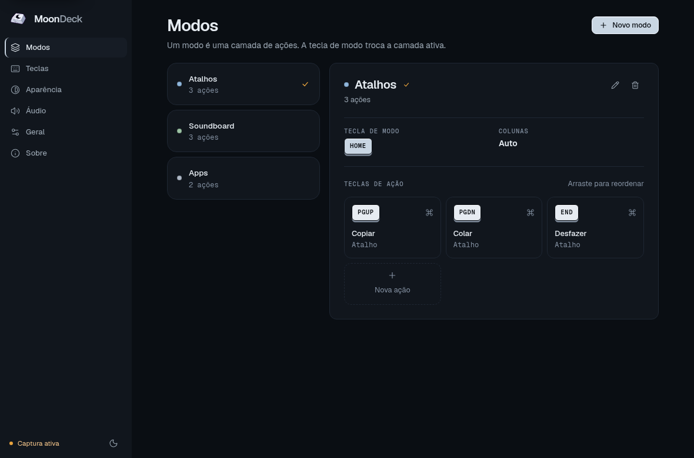
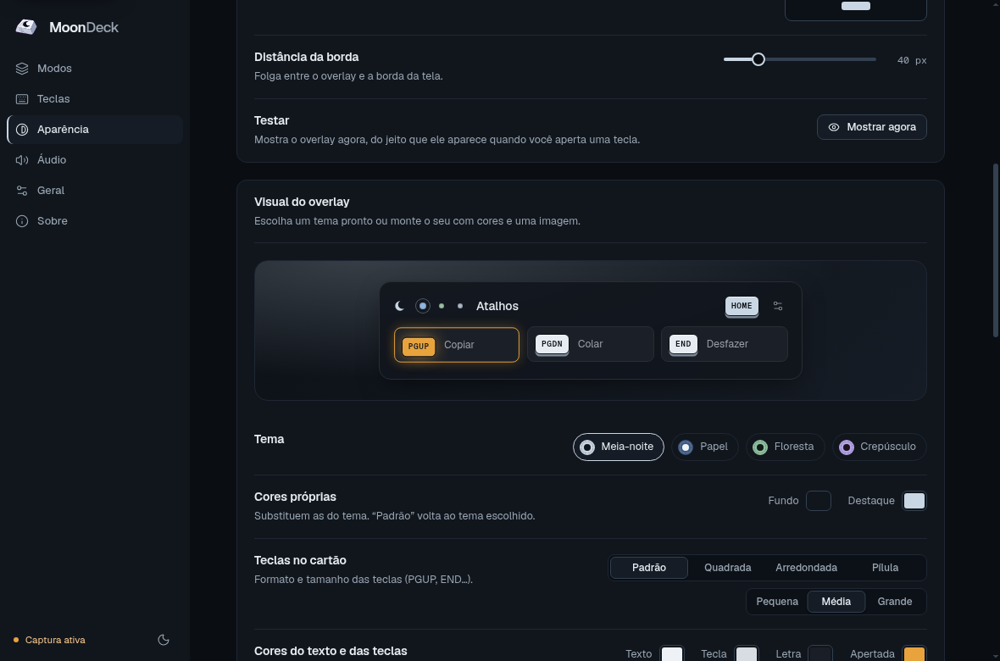

<div align="center">


# MoonDeck

An action deck for the keys you hardly ever use.

[](LICENSE)


[Português](README.md) · **English**

</div>





MoonDeck turns keys such as `Home`, `PgUp`, `PgDn`, `End`, `F13`–`F24` and the
numpad into an action deck organised by **modes**. One key switches the mode; the
others run whatever is bound to them in that mode. An overlay shows the active
mode and its actions.

## Features

- **Built for idle keys and macropads:** `Home`, `PgUp`, `F13`–`F24`, numpad and the keys of a macropad. On Linux, connected macropads are detected and the Keys screen suggests how to use them.
- **Actions:** play a sound (mp3, wav, ogg, flac, m4a) with trim, fade and gain;
  send a shortcut; run a macro (shortcuts, sounds and waits in sequence); open a
  program; apply a voice effect.
- **Modes:** up to 12 modes with 8 actions each, reorderable by drag. Only the
  keys of the active mode are taken from the system; the rest behave normally.
- **Mode key:** one tap shows the mode, a second tap switches. Holding it for 5
  seconds turns on Off mode, where only the mode key stays active.
- **Overlay:** never steals focus. Position, duration, animation, bar or ring
  timer, row or tile buttons, colours, background image and
  [custom CSS](docs/custom-css.md). Themes can be saved, exported and imported.
- **Voice:** 11 real-time effects (deep, high, monster, chipmunk, alien, robot,
  radio, whisper, distortion, echo, cave), also as push-to-talk, and a virtual
  microphone that carries the deck's sounds into Discord, OBS and calls (Linux).
- **Per-button icons:** emoji, image, gif or the icon of the program it opens.
- **Tray and autostart**, a first-run tutorial, English and Portuguese UI, light
  and dark theme.

## Platform support

| | Linux | Windows | macOS |
|---|:-:|:-:|:-:|
| Global keys, sounds, shortcuts, macros, overlay | ✔ | ✔ | ✔ |
| Virtual microphone and voice effects | ✔ | — | — |
| Installed-program list with icons | ✔ | — | — |

Details, dependencies and limits per system: [docs/platforms.md](docs/platforms.md).
Daily use has been on Linux (KDE Plasma, Wayland); Windows and macOS build, but
still need testing on real machines.

## Install

Download the installer for your system from **Releases**. To build from source:

```bash
git clone https://github.com/isaac-const/Moondeck.git
cd Moondeck
pnpm install
pnpm tauri build
```

Requirements: Node 22+, pnpm, stable Rust. On Linux also `webkit2gtk-4.1`,
`gtk3` and `libayatana-appindicator`; `ydotool` for sent shortcuts; PipeWire for audio.

## Usage

1. Open MoonDeck and follow the tutorial.
2. Under **Modes**, create a mode and add actions, each with a key.
3. Press the mode key (default: `Home`) to see the overlay, then use the action keys.

You can repeat the tutorial under **General → Show tutorial**.

## Development

```bash
pnpm install
pnpm tauri dev      # full app: starts the UI and the Rust side together
pnpm dev            # UI only, in the browser, with sample data
pnpm typecheck
pnpm lint
cd src-tauri && cargo test   # also regenerates src/lib/bindings.ts
```

Structure and design notes: [docs/architecture.md](docs/architecture.md).

## Security

- The configuration is written with owner-only permissions (Linux and macOS).
- Overlay CSS is validated and cannot load external resources.
- An imported deck can open programs and send keys: only import decks from
  people you trust.

## License

[MIT](LICENSE)
