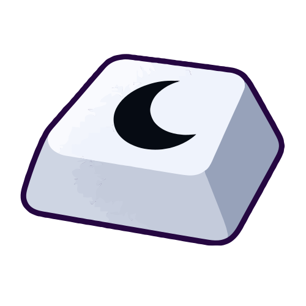
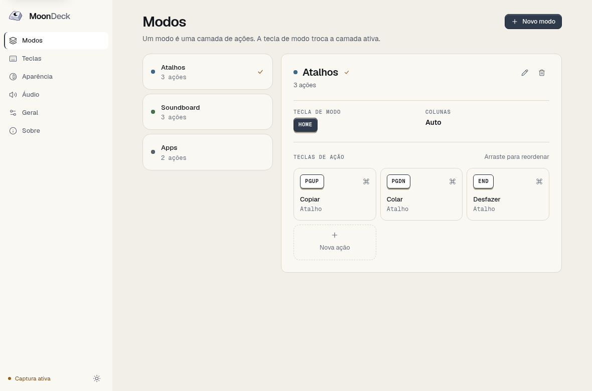
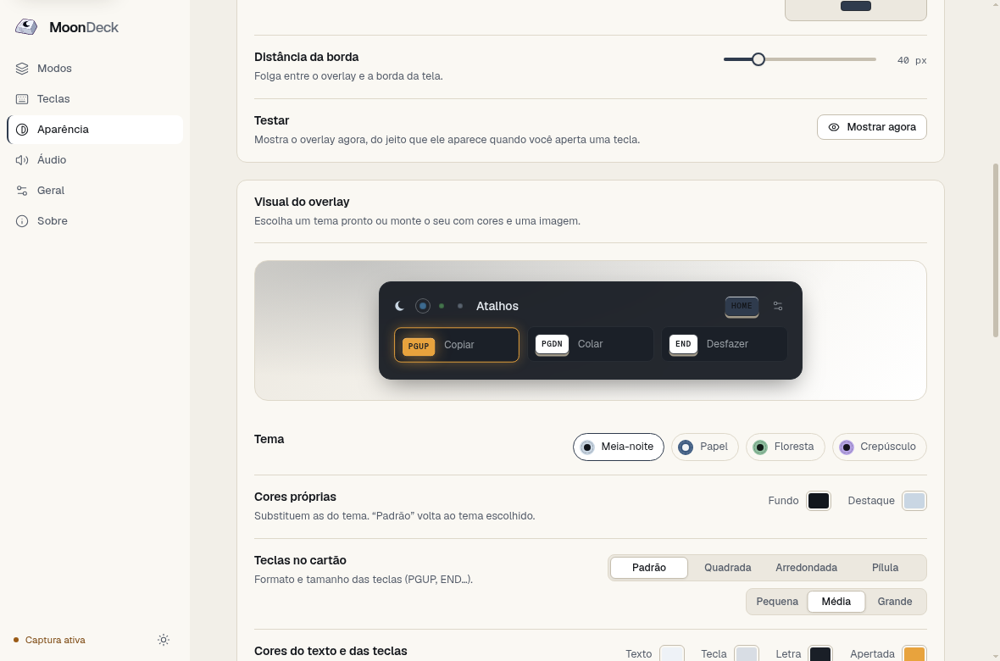

<div align="center">



# MoonDeck

Deck de ações para as teclas que você quase não usa.

[](LICENSE)


**Português** · [English](README.en.md)

</div>





MoonDeck transforma teclas como `Home`, `PgUp`, `PgDn`, `End`, `F13`–`F24` e o
numpad em um deck de ações organizado por **modos**. Uma tecla troca o modo; as
outras executam o que estiver ligado a ela naquele modo. Um overlay mostra o modo
ativo e as ações disponíveis.

## Recursos

- **Pensado para teclas sem uso e macropads:** `Home`, `PgUp`, `F13`–`F24`, numpad e as teclas de um macropad. No Linux, macropads conectados são detectados e a tela Teclas sugere como usá-los.
- **Ações:** tocar som (mp3, wav, ogg, flac, m4a) com corte, fade e ganho; enviar
  atalho; macro (atalhos, sons e esperas em sequência); abrir programa; efeito de voz.
- **Modos:** até 12 modos com 8 ações cada, reordenáveis por arrasto. Só as
  teclas do modo ativo são tomadas do sistema; as demais continuam normais.
- **Tecla de modo:** um toque mostra o modo, o segundo troca. Segurar por 5
  segundos liga o modo Off, em que só ela fica ativa.
- **Overlay:** não rouba o foco. Posição, tempo, animação, temporizador em barra
  ou anel, botões em linha ou quadrados, cores, imagem de fundo e
  [CSS próprio](docs/custom-css.md). Temas podem ser salvos, exportados e importados.
- **Voz:** 11 efeitos em tempo real (grave, agudo, monstro, esquilo, alienígena,
  robô, rádio, sussurro, distorção, eco, caverna), também em modo
  segurar-para-falar, e microfone virtual que leva os sons do deck para o Discord,
  OBS e chamadas (Linux).
- **Ícones por botão:** emoji, imagem, gif ou o ícone do programa aberto.
- **Bandeja e início automático**, tutorial de primeira abertura, interface em
  português e inglês, tema claro e escuro.

## Suporte por sistema

| | Linux | Windows | macOS |
|---|:-:|:-:|:-:|
| Teclas globais, sons, atalhos, macros, overlay | ✔ | ✔ | ✔ |
| Microfone virtual e efeitos de voz | ✔ | — | — |
| Lista de programas com ícone | ✔ | — | — |

Detalhes, dependências e limites de cada sistema: [docs/platforms.md](docs/platforms.md).
O uso diário foi no Linux (KDE Plasma, Wayland); Windows e macOS compilam, mas
ainda precisam de testes em máquina real.

## Instalação

Baixe o instalador do seu sistema em **Releases**. Para compilar:

```bash
git clone https://github.com/isaac-const/Moondeck.git
cd Moondeck
pnpm install
pnpm tauri build
```

Requisitos: Node 22+, pnpm, Rust estável. No Linux, também `webkit2gtk-4.1`,
`gtk3` e `libayatana-appindicator`; para atalhos enviados, `ydotool`; para áudio,
PipeWire.

## Uso

1. Abra o MoonDeck e siga o tutorial.
2. Em **Modos**, crie um modo e adicione ações, cada uma com uma tecla.
3. Aperte a tecla de modo (padrão: `Home`) para ver o overlay e use as teclas das ações.

O tutorial pode ser repetido em **Geral → Rever tutorial**.

## Desenvolvimento

```bash
pnpm install
pnpm tauri dev      # app completo
pnpm dev            # só a interface, no navegador, com dados de exemplo
pnpm typecheck
pnpm lint
cd src-tauri && cargo test   # também regenera src/lib/bindings.ts
```

Estrutura e decisões: [docs/architecture.md](docs/architecture.md).

## Segurança

- A configuração é gravada com permissão só do dono (Linux e macOS).
- O CSS do overlay é validado e não carrega recursos externos.
- Um deck importado pode abrir programas e enviar teclas: importe apenas de quem
  você conhece.

## Licença

[MIT](LICENSE)
